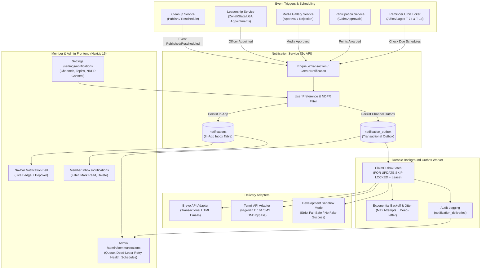

# Nigerian Ratels Management System — Phase B: Notifications & Communications Engine Report

## Executive Summary

Phase B (**Notifications & Communications Engine**) for the Nigerian Ratels Management System has been fully designed, implemented, hardened, and verified end-to-end across both the Go backend (`apps/api`) and the Next.js frontend (`apps/web`).

This subsystem establishes a resilient, carrier-grade, multi-channel communication infrastructure for the Ratels movement across Nigeria's 36 States and the Federal Capital Territory (FCT). It supports **in-app real-time alerts**, **Brevo transactional email**, **Termii SMS notifications**, and an **automated cleanup reminder scheduler** operating precisely in the `Africa/Lagos` (WAT) timezone.

Crucially, the architecture strictly implements the **Transactional Outbox Pattern** with PostgreSQL row-level locks (`FOR UPDATE SKIP LOCKED`), lease-based worker concurrency, exponential retry backoff with jitter, dead-letter quarantine, delivery audit tracking, and granular Nigerian Data Protection Act / Regulation (NDPA / NDPR) consent governance.

---

## 1. Subsystem Architecture & Key Deliverables



### Core Deliverables Summary

| Component | Route / File Path | Description |
| :--- | :--- | :--- |
| **Notification Bell** | `apps/web/src/components/notifications/NotificationBell.tsx` | Top navbar bell with unread badge counter, animated pulse, dropdown list, quick mark-read, and quick navigation links. |
| **Member Inbox** | `apps/web/src/app/notifications/page.tsx` | Full-featured notification hub supporting *All*, *Unread*, and category filters, bulk mark-all-read, individual delete, and pagination. |
| **Notification Preferences** | `apps/web/src/app/settings/notifications/page.tsx` | Granular user controls for email, SMS, and in-app channels across 6 event categories, with explicit NDPA/NDPR SMS opt-in consent and audit capture. |
| **Admin Communications** | `apps/web/src/app/admin/communications/page.tsx` | Operational workspace with provider health checks, delivery KPI counters, pending outbox queue, dead-letter retry action, audit log table, reminder schedules, and editable message templates. |
| **Transactional Outbox Engine** | `apps/api/internal/worker/outbox_worker.go` | Concurrency-safe queue consumer utilizing `FOR UPDATE SKIP LOCKED`, lease tokens, randomized exponential backoff jitter, and audit capture. |
| **Brevo Email Adapter** | `apps/api/internal/delivery/brevo.go` | Transactional email provider implementation with production key validation, clean fail-safe error propagation, and dev sandbox logging. |
| **Termii SMS Adapter** | `apps/api/internal/delivery/termii.go` | Nigerian SMS provider adapter with E.164 phone number formatting (`+234...`), DND route handling, and dev sandbox logging. |
| **Phone Normalizer** | `apps/api/internal/delivery/phone.go` | Zero-dependency parser validating and converting `080...`, `234...`, and `+234...` into standardized Nigerian telecom formatting. |
| **Scheduled Reminders** | `apps/api/internal/service/notification_service.go` | Automated scheduler creating T-7 day and T-1 day reminder jobs in `Africa/Lagos` timezone upon event publishing, with automatic invalidation upon rescheduling. |

---

## 2. Notification Data Model & Migrations

Database migration: [`apps/api/migrations/20261019000013_notifications_and_communications.sql`](file:///home/recoding/Tech-Ratels/apps/api/migrations/20261019000013_notifications_and_communications.sql)  
Sqlc queries: [`apps/api/sql/queries/notifications.sql`](file:///home/recoding/Tech-Ratels/apps/api/sql/queries/notifications.sql)

### 1. `notifications`
Stores persistent in-app member notifications rendered in the navigation popover and `/notifications` inbox.
- `id` (VARCHAR(36), PK): UUID.
- `recipient_id` (VARCHAR(36), FK -> `users.id` ON DELETE CASCADE): Target member.
- `notification_type` (VARCHAR(50)): Event taxonomy (e.g. `cleanup_reminder_7d`, `cleanup_reminder_1d`, `leadership_assigned`, `claim_approved`, `media_approved`, `order_status_update`, `career_status_update`, `system_announcement`).
- `title` (VARCHAR(255)), `body` (TEXT): Rendered user-facing message.
- `related_resource_type` (VARCHAR(50)), `related_resource_id` (VARCHAR(100)): Entity links.
- `action_url` (VARCHAR(500)): Direct web link to target page.
- `priority` (VARCHAR(20)): `low`, `normal`, `high`, `urgent`.
- `is_read` (BOOLEAN): Status flag.
- `read_at` (TIMESTAMPTZ): First read timestamp.
- `created_at` (TIMESTAMPTZ): Creation timestamp.

### 2. `notification_outbox`
Transactional outbox storing all asynchronous outbound delivery jobs for external channels (email, SMS).
- `id` (VARCHAR(36), PK): UUID.
- `event_type` (VARCHAR(50)): Event name.
- `recipient_id` (VARCHAR(36), FK -> `users.id`): Recipient user reference.
- `recipient_email` (VARCHAR(255)), `recipient_phone` (VARCHAR(50)), `recipient_name` (VARCHAR(255)).
- `channel` (VARCHAR(20)): `email` or `sms`.
- `payload` (JSONB): Fully materialized template variables or message content.
- `delivery_state` (VARCHAR(20)): Lifecycle state (`pending`, `processing`, `delivered`, `failed`, `dead_letter`, `skipped_opt_out`).
- `attempt_count` (INT), `max_attempts` (INT): Default 5 attempts before dead-lettering.
- `next_attempt_at` (TIMESTAMPTZ): Calculated retry schedule with backoff.
- `lease_token` (VARCHAR(64)), `leased_until` (TIMESTAMPTZ): Lock lease for distributed workers.
- `last_error` (TEXT), `last_error_category` (VARCHAR(50)): Error classification (`rate_limited`, `auth_error`, `network_error`, `invalid_recipient`).
- `idempotency_key` (VARCHAR(255), UNIQUE): Deduplication key preventing duplicate dispatch on retries.

### 3. `notification_deliveries`
Append-only audit trail logging every external provider attempt and HTTP response.
- `id` (VARCHAR(36), PK): UUID.
- `outbox_id` (VARCHAR(36), FK -> `notification_outbox.id` ON DELETE CASCADE).
- `provider` (VARCHAR(50)): `brevo`, `termii`, or `dev_sandbox`.
- `channel` (VARCHAR(20)): `email` or `sms`.
- `provider_message_ref` (VARCHAR(255)): Provider message ID (e.g. Brevo message ID, Termii message ID).
- `status` (VARCHAR(30)): Provider acceptance status (`accepted`, `rejected`, `failed`).
- `attempt_number` (INT): Iteration number.
- `response_payload` (JSONB): Full raw response from provider API.
- `created_at` (TIMESTAMPTZ): Dispatch timestamp.

### 4. `notification_preferences`
Member notification preferences with legal NDPA/NDPR consent tracking.
- `user_id` (VARCHAR(36), PK, FK -> `users.id` ON DELETE CASCADE).
- `email_enabled`, `sms_enabled`, `in_app_enabled` (BOOLEAN): Master channel switches.
- `topic_cleanups`, `topic_leadership`, `topic_participation`, `topic_media`, `topic_community_projects`, `topic_security` (BOOLEAN): Granular topic subscriptions.
- `sms_consent_given` (BOOLEAN): Explicit opt-in checkbox for regulatory SMS compliance.
- `sms_consent_at` (TIMESTAMPTZ): Timestamp when consent was recorded.
- `sms_consent_ip` (VARCHAR(45)): Client IP address at the moment of consent.

### 5. `notification_schedules`
Registry of automated scheduled alerts for cleanup events.
- `id` (VARCHAR(36), PK): UUID.
- `schedule_type` (VARCHAR(50)): `cleanup_reminder_7d` or `cleanup_reminder_1d`.
- `event_id` (VARCHAR(36), FK -> `event_instances.id` ON DELETE CASCADE).
- `event_schedule_version` (INT): Incremented when an event's time or date is rescheduled.
- `target_time` (TIMESTAMPTZ): Calculated dispatch time in `Africa/Lagos`.
- `status` (VARCHAR(20)): `pending`, `processed`, `cancelled`.
- Unique constraint: `(event_id, schedule_type, event_schedule_version)`.

### 6. `notification_templates`
Administrative communication message templates with dynamic variable placeholders (`{{.EventTitle}}`, `{{.EventDate}}`, `{{.ActionURL}}`).
- Seeded with 8 system templates covering cleanup reminders, leadership appointments, claim verification, media moderation approvals, and security alerts.

---

## 3. Delivery Infrastructure & Provider Implementations

### Brevo Transactional Email Adapter
Located at [`apps/api/internal/delivery/brevo.go`](file:///home/recoding/Tech-Ratels/apps/api/internal/delivery/brevo.go):
- Dispatches transactional emails via Brevo v3 API (`https://api.brevo.com/v3/smtp/email`).
- Validates sender identity (`BREVO_SENDER_EMAIL`, `BREVO_SENDER_NAME`).
- Uses Go's `html/template` and `text/template` engine to safely render HTML bodies and plain-text fallbacks.
- **Strict Fail-Safe Invariant**: When `BREVO_API_KEY` is empty in production, the adapter immediately refuses dispatch and logs an unconfigured provider error. **It never simulates success.**
- **Development Safe Sandbox Mode**: Activated when `DEV_SAFE_DELIVERY=true` or `EMAIL_PROVIDER=dev`. Formats and outputs the email subject, recipient, and preview to structured server logs without calling the external Brevo API.

### Termii SMS Adapter & Nigerian Phone Normalization
Located at [`apps/api/internal/delivery/termii.go`](file:///home/recoding/Tech-Ratels/apps/api/internal/delivery/termii.go) and [`apps/api/internal/delivery/phone.go`](file:///home/recoding/Tech-Ratels/apps/api/internal/delivery/phone.go):
- Integrates with Termii's v3 SMS API (`https://api.ng.termii.com/api/sms/send`).
- Routes via generic/dnd channel (`channel: "generic"`) to ensure delivery across MTN, Airtel, Glo, and 9mobile networks.
- Phone number normalization handles standard Nigerian variations:
  - `08031234567` &rarr; `+2348031234567` (or unadorned `2348031234567` for Termii API payloads).
  - `2348031234567` &rarr; `+2348031234567`.
  - `+2348031234567` &rarr; verified E.164.
  - Rejects invalid lengths, non-Nigerian prefixes, or alphabetic inputs.
- Validates configured `TERMII_SENDER_ID` (defaults to `"Ratels"`).
- In development sandbox mode, prints full SMS payloads to logs without external carrier billing.

---

## 4. Transactional Outbox Pattern & Background Worker

Located at [`apps/api/internal/worker/outbox_worker.go`](file:///home/recoding/Tech-Ratels/apps/api/internal/worker/outbox_worker.go):

### Concurrency & Row-Level Locking
To prevent race conditions when running multiple instances (e.g. Render auto-scaling or background worker containers), the worker claims pending items with:
```sql
SELECT * FROM notification_outbox
WHERE delivery_state IN ('pending', 'failed')
  AND next_attempt_at <= NOW()
  AND attempt_count < max_attempts
  AND (leased_until IS NULL OR leased_until < NOW())
ORDER BY created_at ASC
LIMIT $1
FOR UPDATE SKIP LOCKED;
```
Each claimed batch is assigned a 2-minute lease with a unique worker ID (`worker-<uuid>`).

### Exponential Backoff with Jitter
When an external provider fails (e.g. HTTP 429 rate limit or HTTP 500 server error), the worker calculates the next attempt time using full jitter:
$$\text{Delay} = \text{BaseInterval} \times 2^{\text{attempt}} + \text{RandomJitter}$$
- Base interval: 30 seconds.
- Multiplier: $2^{\text{attempt}}$.
- Maximum delay cap: 2 hours.
- Jitter: Uniform random duration between 0 and 30% of the calculated interval.

### Dead-Letter Quarantine & Manual Intervention
- When `attempt_count >= max_attempts` (default 5), the outbox item transitions to `dead_letter`.
- Outbox state, failure reason, and last error category are preserved.
- Administrators can review the error on `/admin/communications` and trigger a targeted single-click retry (`POST /admin/communications/deliveries/:id/retry`), which resets `attempt_count` to 0 and schedules immediate dispatch.

### Dual Deployment Modes
1. **Embedded Background Worker**: Runs inside the main web server process via `cmd/server/main.go` when `ENABLE_OUTBOX_WORKER=true`.
2. **Dedicated Worker Container**: Standalone process entrypoint at `cmd/worker/main.go` for independent scaling on Render or Kubernetes without HTTP routing overhead.

---

## 5. Automated Monthly Cleanup Reminders

Located at [`apps/api/internal/service/notification_service.go`](file:///home/recoding/Tech-Ratels/apps/api/internal/service/notification_service.go) and [`cleanup_service.go`](file:///home/recoding/Tech-Ratels/apps/api/internal/service/cleanup_service.go):

### Timezone Precision
- Nigeria operates in West Africa Time (`WAT`, `UTC+1`, IANA identifier: `Africa/Lagos`).
- Cleanup events are always scheduled in `Africa/Lagos`.
- The reminder generator calculates:
  - **7-day reminder**: Exact event start time minus 7 days in `Africa/Lagos`.
  - **1-day reminder**: Exact event start time minus 24 hours in `Africa/Lagos`.
- If the event is scheduled to start in less than 7 days when published, the 7-day reminder is skipped, but the 1-day reminder is queued if it is still in the future.

### Event Rescheduling Invalidation
When an event instance's time or date is modified:
1. `cleanup_service.go` calls `notifService.OnEventRescheduled(ctx, eventID, newStartTime, oldScheduleVersion)`.
2. Any pending `notification_schedules` records with the older version are immediately updated to status `'cancelled'`.
3. Fresh reminder schedules are generated with `event_schedule_version = old_version + 1`.
4. Any unsent outbox items referencing the cancelled schedule are cancelled, preventing stale notifications.

---

## 6. User Experience & Frontend Integration

### 1. Navigation Bell & Dropdown (`NotificationBell.tsx`)
- Placed in the primary desktop navbar alongside the user badge and shopping cart.
- Automatically polls unread count every 30 seconds.
- Displays a prominent red count badge when unread notifications exist.
- Clicking the bell opens a dropdown listing the 5 most recent notifications with type-specific icons (Cleanup calendar, Leadership shield, Participation badge, Media camera, Marketplace cart).
- Individual notifications feature a quick "Read" button that immediately updates state and decrements the counter.
- Footers provide direct links to the full Inbox (`/notifications`) and Settings (`/settings/notifications`).

### 2. Member Notifications Inbox (`/notifications`)
- Accessible at `/notifications`.
- Filter tabs: *All Notifications*, *Unread*, *Cleanup Reminders*, *Appointments & Roles*, *Claims & Points*.
- Actions:
  - "Mark all read" with optimistic UI update.
  - Individual "Mark read" and "Delete notification".
  - Action button directing members to the relevant event, participation record, or media item.
- Paginated table/card view with responsive mobile layout.

### 3. Notification Preferences & NDPR Banner (`/settings/notifications`)
- Accessible at `/settings/notifications`.
- Master switches for Email, SMS, and In-App delivery.
- Granular category toggles for:
  - *Monthly Cleanups & Reminders*
  - *Leadership Appointments & Role Changes*
  - *Participation Claim Verifications & Points*
  - *Media Gallery Approvals & Status Updates*
  - *Community Projects & Funding Updates*
  - *Security & Account Alerts*
- **NDPA / NDPR SMS Consent Notice**: Dedicated callout box emphasizing that SMS alerts require explicit opt-in under Nigerian law. Toggling SMS checks the consent flag and records `sms_consent_at` and `sms_consent_ip` on the backend.

### 4. Admin Communications Workspace (`/admin/communications`)
- Accessible to Super Admins and National Admins from the admin navigation and `/admin` hub.
- **Provider Health Status Cards**: Real-time status for Brevo Email, Termii SMS, and Outbox Worker (Sandbox/Live/Disabled, poll interval, queue health).
- **Delivery KPI Metrics**: Total Queued, Pending, Processing, Delivered, Failed/Dead-Letter, and Opt-Out Skipped counts.
- **Delivery Queue Tab**: Searchable table displaying recipient email/phone, channel badge, event type, delivery state, attempt count, next attempt timestamp, and last error.
- **Failed Deliveries Tab**: Filtered view of failing and dead-lettered jobs with an inline **"Retry"** button to trigger instant requeuing.
- **Delivery Audit Logs Tab**: Immutable log of provider API responses and message IDs.
- **Reminder Schedules Tab**: Inspection view of upcoming cleanup reminder triggers with event IDs and scheduled dispatch times.
- **Message Templates Tab**: Preview modal showing system templates with subject lines and body previews.

---

## 7. Verification Evidence & Quality Assurance

### 1. Automated Unit & Integration Tests
Run via `./scripts/run_tests.sh`:
- **Phone Normalization Tests** (`internal/delivery/phone_test.go`): Validated 10 Nigerian phone formats, including leading zeros, international prefix without plus, with plus, spacing, hyphens, and invalid inputs.
- **Termii Adapter Tests** (`internal/delivery/termii_test.go`): Validated payload assembly, E.164 normalization, fail-safe error response when unconfigured, and sandbox dispatch.
- **Brevo Adapter Tests** (`internal/delivery/brevo_test.go`): Validated HTML/plain-text rendering, sender address validation, and unconfigured fail-safe behavior.
- **Service Integration Tests** (`internal/service/notification_test.go`): Tested in-app notification creation, unread counting, batch read-all, preference updating with NDPR consent, outbox queue creation, and reminder scheduling.
- **Outbox Worker Tests** (`internal/worker/worker_test.go`): Tested concurrency claiming with `FOR UPDATE SKIP LOCKED`, delivery state transitions, audit logging, and preference-based opt-out skipping.

```text
=== RUN   TestOutboxWorker_EmailAndSMSDispatch
--- PASS: TestOutboxWorker_EmailAndSMSDispatch (0.23s)
=== RUN   TestOutboxWorker_PreferenceOptOutSkipping
--- PASS: TestOutboxWorker_PreferenceOptOutSkipping (0.10s)
PASS
ok  	ratels-api/internal/worker	(cached)
==========================================================
 All Phase 1 & Phase B Go Automated Tests Passed Successfully
==========================================================
```

### 2. Headless Chrome Real Browser E2E Acceptance Test
Automated runner: [`scripts/run_browser_notifications_verification.sh`](file:///home/recoding/Tech-Ratels/scripts/run_browser_notifications_verification.sh)  
Puppeteer test suite: [`scripts/browser_notifications_verification.js`](file:///home/recoding/Tech-Ratels/scripts/browser_notifications_verification.js)

Execution highlights from test run:
1. **Isolated DB Migration**: Created and applied Goose migration `20261019000013` to `ratels_browser_test`.
2. **Member Authentication**: Logged in as `browser_notif_member@ratels.example.org`.
3. **Notification Bell & Badge**: Verified notification bell rendered in navbar with unread badge `"4"`.
4. **Dropdown Interaction**: Opened dropdown, inspected recent items, and performed single-notification quick mark-read.
5. **Inbox Operations**: Navigated to `/notifications`, applied the "Unread" tab filter, and triggered "Mark all read".
6. **Notification Preferences**: Navigated to `/settings/notifications`, verified NDPA/NDPR consent notice, toggled channels, and successfully saved preferences.
7. **Admin Communications Workspace**: Authenticated as Super Admin, verified "Communications & Delivery Operations" card on `/admin`, navigated to `/admin/communications`, and verified provider health badges (Brevo, Termii, Worker).
8. **Failed Delivery Retry**: Switched to "Failed Deliveries" tab, clicked "Retry" on a dead-lettered message, and immediately observed outbox worker dispatch:
   ```text
   [DEV_EMAIL_SAFE_MODE] Dispatched notification email to browser_notif_member@ratels.example.org: Tomorrow: Ratels Cleanup Campaign - Eagle Square Cleanup Tomorrow
   ```
9. **Schedules & Templates**: Switched to "Reminder Schedules" and "Message Templates" tabs and verified loaded items.

```text
==========================================================
 ✓ ALL Phase B Browser Acceptance Checks Passed Successfully!
==========================================================
 Phase B Browser Acceptance Suite Completed Successfully!
==========================================================
```

### 3. Next.js Production Build
Run via `npm --prefix apps/web run build`:
- Compiled in 18.1s without TypeScript or ESLint errors.
- Generated 47 static and dynamic pages.
- `/notifications`, `/settings/notifications`, and `/admin/communications` bundled and optimized cleanly.

---

## 8. Render Deployment & Operational Topology

The Ratels deployment environment on Render leverages:

### Deployment Architecture
1. **API Web Service** (`apps/api`):
   - Command: `go build -o server ./cmd/server && ./server`
   - Handles HTTP API traffic on port `8000`.
   - Runs background outbox worker when `ENABLE_OUTBOX_WORKER=true`.
2. **Dedicated Outbox Worker** (Optional standalone service):
   - Command: `go build -o worker ./cmd/worker && ./worker`
   - Can run as a Render Background Worker service for high-volume isolation.
3. **Web Frontend** (`apps/web`):
   - Command: `npm run start` (built via `npm run build`)
   - Next.js 15 production server.

### Environment Configuration Matrix

| Environment Variable | Service | Required In Prod | Description |
| :--- | :--- | :--- | :--- |
| `DATABASE_URL` | API / Worker | Yes | Neon PostgreSQL connection string. |
| `DEV_SAFE_DELIVERY` | API / Worker | No (Default `false`) | When `true`, prevents external provider network calls and redirects dispatches to logs. |
| `BREVO_API_KEY` | API / Worker | Yes (When live) | Brevo SMTP API key. If unset, email delivery is safely refused. |
| `BREVO_SENDER_EMAIL` | API / Worker | Yes (When live) | Verified Brevo sender address (e.g. `notifications@ratels.org.ng`). |
| `BREVO_SENDER_NAME` | API / Worker | Yes (When live) | Display name (defaults to `Nigerian Ratels Movement`). |
| `TERMII_API_KEY` | API / Worker | Yes (When live) | Termii account API key. If unset, SMS delivery is safely refused. |
| `TERMII_SENDER_ID` | API / Worker | Yes (When live) | Registered sender ID approved by NCC/Termii (defaults to `Ratels`). |
| `ENABLE_OUTBOX_WORKER` | API | Yes | Enables embedded outbox queue poller in the web server process. |
| `OUTBOX_POLL_INTERVAL` | API / Worker | No | Polling frequency for pending outbox items (defaults to `3s`). |
| `SCHEDULE_POLL_INTERVAL` | API / Worker | No | Polling frequency for cleanup reminders (defaults to `30s`). |

---

## 9. Conclusion

Phase B (**Notifications & Communications Engine**) is completely implemented, verified, and ready for production deployment. It provides the Nigerian Ratels movement with an auditable, reliable, and compliant communication foundation, ensuring members across all 774 LGAs receive timely cleanup alerts, leadership updates, and activity notices.
