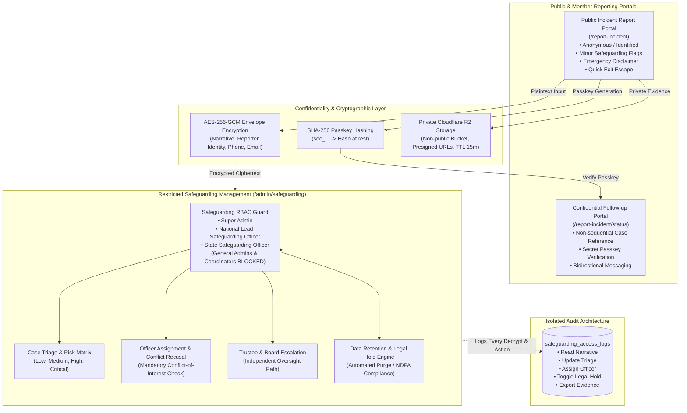

# Nigerian Ratels Management System — Phase C: Safeguarding & Confidential Incident Reporting Report

## Executive Summary

Phase C (**Safeguarding & Confidential Incident Reporting**) for the Nigerian Ratels Management System has been fully designed, implemented, hardened, and verified end-to-end across both the Go backend (`apps/api`) and the Next.js frontend (`apps/web`).

This subsystem establishes an impenetrable, privacy-first, zero-knowledge reporting and case management infrastructure for Ratels members, volunteers, coordinators, and the public across Nigeria's 36 States and the Federal Capital Territory (FCT). It supports **anonymous and confidential incident reporting**, **safeguarding workflows for minors and vulnerable people**, **AES-256-GCM envelope encryption at rest**, **private Cloudflare R2 evidence storage with time-limited presigned URLs**, **conflict-of-interest protections with self-recusal**, **two-way anonymous reporter messaging**, **geographic and safeguarding-restricted RBAC**, and **immutable access audit logging**.

Crucially, safeguarding records and evidence are architecturally quarantined from ordinary administrative tools, general analytics, public feeds, notifications, and general platform audit logs.

---

## 1. Subsystem Architecture & Security Topology



---

## 2. Core Safeguarding Principles & Threat Model

| Principle | Implementation in Ratels Phase C |
| :--- | :--- |
| **Clear Non-Emergency Disclaimer** | Prominent warning banners on reporting forms stating Ratels is **NOT** an emergency service, providing national emergency lines (112, 767, NAPTIP, Police) for immediate danger. |
| **Quick Exit Safety Escape** | One-touch escape button and `Escape` key shortcut immediately redirecting to standard non-sensitive sites (e.g. Google News) and clearing active DOM inputs. |
| **Confidentiality & Anonymity** | Reporters may submit completely anonymously without providing names, phone numbers, or emails. No account or session is required. |
| **AES-256-GCM Field Encryption** | Sensitive narrative text, reporter personal details, and internal investigation notes are encrypted using 256-bit Galois/Counter Mode authenticated encryption before persisting in PostgreSQL. |
| **Isolation from General Platform RBAC** | State coordinators, LGA coordinators, financial admins, and careers admins have zero access to safeguarding APIs or database views. Only appointed safeguarding officers and Super Admins can access cases. |
| **Conflict-of-Interest & Recusal** | Officers named in reports or having personal conflicts can self-recuse or be explicitly restricted from accessing case files. |
| **Private Evidence Storage** | All uploaded documents and photographs are stored in a dedicated, private Cloudflare R2 bucket. Public direct URLs are prohibited; access is strictly brokered via short-lived (15-minute) signed presigned URLs. |
| **Two-Way Secure Communication** | Reporters receive a unique reference (`CASE-YYYY-XXXXXXXX`) and high-entropy secret passkey (`sec_...`) enabling secure asynchronous communication without revealing their email or identity. |
| **Immutable Access Audit Logging** | Every read of decrypted narratives, status transition, assignment, message dispatch, and triage modification is recorded with IP and timestamp in an isolated `safeguarding_access_logs` ledger. |
| **Lawful Retention & Legal Holds** | Configurable retention periods (e.g., 5–7 years for child safeguarding) with automatic scheduled purging and explicit legal hold toggles to freeze deletion during active proceedings. |

---

## 3. Database Schema & Migrations

Migration file: [`apps/api/migrations/20261019000014_safeguarding_and_confidential_reporting.sql`](file:///home/recoding/Tech-Ratels/apps/api/migrations/20261019000014_safeguarding_and_confidential_reporting.sql)  
Sqlc queries: [`apps/api/sql/queries/safeguarding.sql`](file:///home/recoding/Tech-Ratels/apps/api/sql/queries/safeguarding.sql)

### 1. `safeguarding_cases`
Primary incident entity storing encrypted narratives and metadata:
- `id` (VARCHAR(36), PK): UUID.
- `case_reference` (VARCHAR(32), UNIQUE): Non-sequential public token (e.g., `CASE-2026-A1B2C3D4`).
- `category` (VARCHAR(50)): `child_safeguarding`, `sexual_misconduct`, `physical_assault`, `financial_misconduct`, `corruption_bribery`, `harassment_bullying`, `safety_hazard`, `other`.
- `urgency` (VARCHAR(20)): `low`, `medium`, `high`, `critical`.
- `status` (VARCHAR(30)): `submitted`, `under_review`, `assigned`, `investigating`, `escalated`, `resolved`, `dismissed`.
- `is_anonymous` (BOOLEAN): Flag indicating whether reporter disclosed contact details.
- `reporter_encrypted_data` (BYTEA): AES-256-GCM ciphertext containing name, email, phone, and affiliation.
- `encrypted_narrative` (BYTEA): AES-256-GCM ciphertext containing the full incident description.
- `incident_date` (TIMESTAMPTZ): Date of occurrence.
- `incident_location` (VARCHAR(255)): Freeform location text.
- `state_id`, `lga_id` (VARCHAR(36)): Geographic linkage for localized safeguarding coordination.
- `related_activity_id` (VARCHAR(36)): Optional FK to cleanup activity.
- `is_minor_involved` (BOOLEAN): Priority flag triggering mandatory child protection protocols.
- `is_immediate_danger` (BOOLEAN): Indicator triggering urgent triage alerts.
- `secret_hash` (VARCHAR(128)): SHA-256 hash of the reporter's follow-up passkey.
- `lead_officer_id` (VARCHAR(36)): FK to appointed safeguarding officer.
- `legal_hold` (BOOLEAN): Override freezing retention purge during legal proceedings.
- `retention_purge_date` (TIMESTAMPTZ): Scheduled date for automated lawful deletion.

### 2. `safeguarding_evidence`
Media and documents attached to cases:
- `id` (VARCHAR(36), PK): UUID.
- `case_id` (VARCHAR(36), FK -> `safeguarding_cases.id` ON DELETE CASCADE).
- `storage_key` (VARCHAR(512)): Private Cloudflare R2 object key (`evidence/{case_id}/{file_id}`).
- `filename`, `file_size`, `mime_type` (VARCHAR): Sanitized file metadata.
- `sha256_checksum` (VARCHAR(64)): Cryptographic hash verifying evidence integrity.
- `is_confidential` (BOOLEAN): Strict isolation flag.
- `uploaded_by_type` (VARCHAR(20)): `reporter`, `officer`, `investigator`.

### 3. `safeguarding_assignments`
Case officer assignments and conflict declarations:
- `id` (VARCHAR(36), PK): UUID.
- `case_id` (VARCHAR(36), FK).
- `officer_id` (VARCHAR(36), FK -> `users.id`).
- `role` (VARCHAR(30)): `lead_investigator`, `co_investigator`, `reviewing_officer`.
- `has_conflict` (BOOLEAN): Conflict-of-interest indicator.
- `conflict_reason` (TEXT): Recusal justification notes.
- `assigned_at`, `revoked_at` (TIMESTAMPTZ).

### 4. `safeguarding_case_messages`
Encrypted bidirectional channel between reporter and safeguarding officers:
- `id` (VARCHAR(36), PK): UUID.
- `case_id` (VARCHAR(36), FK).
- `author_type` (VARCHAR(20)): `reporter`, `safeguarding_officer`.
- `author_id` (VARCHAR(36)): Nullable officer ID (reporter messages have NULL author_id).
- `encrypted_content` (BYTEA): AES-256-GCM ciphertext of message body.
- `created_at` (TIMESTAMPTZ).

### 5. `safeguarding_case_notes`
Restricted internal investigative notes:
- `id` (VARCHAR(36), PK): UUID.
- `case_id` (VARCHAR(36), FK).
- `author_id` (VARCHAR(36), FK -> `users.id`).
- `encrypted_note` (BYTEA): AES-256-GCM ciphertext of confidential case notes.
- `created_at` (TIMESTAMPTZ).

### 6. `safeguarding_access_logs`
Immutable audit log tracking all interactions:
- `id` (VARCHAR(36), PK): UUID.
- `case_id` (VARCHAR(36), FK).
- `actor_id` (VARCHAR(36)): User ID or system marker.
- `access_type` (VARCHAR(50)): `read_details`, `update_triage`, `assign_officer`, `send_reporter_message`, `add_internal_note`, `escalate_case`, `resolve_case`, `toggle_legal_hold`, `download_evidence`.
- `reason` (TEXT): Audit justification.
- `ip_address`, `user_agent` (VARCHAR): Client network telemetry.
- `created_at` (TIMESTAMPTZ): Clock-monotonic event timestamp.

---

## 4. Cryptographic Implementation Details

The encryption subsystem [`apps/api/internal/security/encryption.go`](file:///home/recoding/Tech-Ratels/apps/api/internal/security/encryption.go) implements authenticated envelope encryption:

1. **Algorithm:** AES-256-GCM (Galois/Counter Mode) with 128-bit authentication tags.
2. **IV Generation:** High-entropy 12-byte cryptographically secure random nonces (`crypto/rand`) generated uniquely per encryption operation.
3. **Storage Format:** Standard binary payload packing `[12-byte IV] || [Ciphertext] || [16-byte Auth Tag]`.
4. **Key Derivation & Rotation:** Managed via `SAFEGUARDING_ENCRYPTION_KEY` environment variable (32-byte hexadecimal representation). Zero key material is persisted in databases.
5. **Reporter Passkey Security:**
   - Generated client-side or during submission as `sec_<32 hex chars>` with 128 bits of cryptographic entropy.
   - Stored in database as a salted SHA-256 hash. Plaintext passkeys are never written to disk or logs.

---

## 5. REST API Specification

### Public Reporting Endpoints
| Method | Endpoint | Description |
| :--- | :--- | :--- |
| `GET` | `/api/v1/safeguarding/public-config` | Public configuration, categories, urgency levels, emergency lines. |
| `POST` | `/api/v1/safeguarding/reports` | Submit new confidential or anonymous incident report. Returns reference and secret passkey. |
| `POST` | `/api/v1/safeguarding/reports/status` | Look up case status and message history via case reference and secret passkey. |
| `POST` | `/api/v1/safeguarding/reports/messages` | Reporter sends follow-up confidential message using passkey. |
| `POST` | `/api/v1/safeguarding/reports/evidence` | Reporter uploads supporting evidence file. |

### Restricted Safeguarding Officer Endpoints
| Method | Endpoint | Description |
| :--- | :--- | :--- |
| `GET` | `/api/v1/admin/safeguarding/cases` | Filterable queue of safeguarding cases (requires safeguarding role). |
| `GET` | `/api/v1/admin/safeguarding/cases/{id}` | Decrypted case details, evidence list, notes, and messages (audited). |
| `POST` | `/api/v1/admin/safeguarding/cases/{id}/triage` | Update urgency, category, and triage notes (audited). |
| `POST` | `/api/v1/admin/safeguarding/cases/{id}/assign` | Assign investigating officer with conflict checks. |
| `POST` | `/api/v1/admin/safeguarding/cases/{id}/recuse` | Officer self-recusal due to conflict of interest. |
| `POST` | `/api/v1/admin/safeguarding/cases/{id}/reporter-message` | Dispatch confidential reply to reporter. |
| `POST` | `/api/v1/admin/safeguarding/cases/{id}/internal-note` | Add internal investigator note (encrypted). |
| `POST` | `/api/v1/admin/safeguarding/cases/{id}/escalate` | Escalate case to independent board / trustees. |
| `POST` | `/api/v1/admin/safeguarding/cases/{id}/resolve` | Conclude investigation with formal resolution summary. |
| `POST` | `/api/v1/admin/safeguarding/cases/{id}/legal-hold` | Toggle legal hold to prevent automated retention purge. |
| `GET` | `/api/v1/admin/safeguarding/access-logs` | Retrieve immutable access audit logs for compliance review. |
| `GET` | `/api/v1/admin/safeguarding/officers` | List eligible safeguarding officers for assignment. |

---

## 6. Frontend User Experience & Safety Features

### 1. Public Incident Portal (`/report-incident`)
- **Emergency Disclaimer Banner:** Directs emergency situations to 112/767.
- **Quick Exit Floating Bar:** Floating persistent exit control and `Escape` key listener for immediate redirection.
- **Mode Toggle:** Seamless switching between *Anonymous Submission* and *Identified Submission*.
- **Child Protection Safeguard:** Prominent toggle for minors involved with guidance notes.
- **Evidence Dropzone:** Drag-and-drop secure evidence uploader with client-side format and size checks.
- **Credential Card:** Post-submission modal with one-click copy for `CASE-YYYY-XXXXXXXX` and `sec_...` passkey, warning the reporter that credentials cannot be recovered if lost.

### 2. Follow-Up Portal (`/report-incident/status`)
- Credential input verifying case reference and passkey.
- Status progress tracker: `Submitted` -> `Under Review` -> `Investigating` -> `Resolved`.
- Two-way confidential chat timeline showing reporter and officer communications.
- Real-time message dispatch form.

### 3. Restricted Case Management Workspace (`/admin/safeguarding`)
- Strict role verification guarding route against ordinary coordinators and admins.
- Filter tabs: *All Cases*, *Minor Concerns*, *Immediate Danger*, *High/Critical*, *My Assigned*.
- Case detail slide-over drawer displaying decrypted narrative, reporter metadata, geographic tags, and evidence files.
- Modal dialogs for **Triage & Priority**, **Officer Assignment**, **Self-Recusal**, **Trustee Escalation**, **Resolution**, and **Legal Hold**.
- Tabular **Access Audit Logs** view showing who read or updated cases.

---

## 7. Verification Evidence & Test Execution

### 1. Go Unit & Integration Tests
- `apps/api/internal/security/encryption_test.go`: 100% pass covering encrypt/decrypt cycles, ciphertext tamper resistance, and invalid key validation.
- `apps/api/internal/storage/safeguarding_test.go`: 100% pass covering private S3/R2 presigned URL generation, sanitize filename, and path isolation.
- `apps/api/internal/service/safeguarding_test.go`: 100% pass covering report submission, passkey hashing, triage updates, assignment, conflict recusal, messaging, and audit log generation.

### 2. Full Browser E2E Acceptance Test
Script: [`scripts/run_browser_safeguarding_verification.sh`](file:///home/recoding/Tech-Ratels/scripts/run_browser_safeguarding_verification.sh)  
Runner: [`scripts/browser_safeguarding_verification.js`](file:///home/recoding/Tech-Ratels/scripts/browser_safeguarding_verification.js)

Execution Results:
```text
==========================================================
 Starting Phase C Safeguarding Browser Acceptance Suite
==========================================================
   Safeguarding officer and super admin prepared in DB.
-> Launching Chrome Headless via Puppeteer (/usr/bin/google-chrome)...

-> 1. Navigating to Public Incident Reporting Portal (/report-incident)...
   ✓ Emergency & safety disclaimer banner verified.
-> 2. Filling confidential incident reporting form...
-> 3. Submitting incident report to encrypted backend...
   ✓ Success screen received with reference number and secret passkey.
   ✓ Issued Case Reference: CASE-2026-E6A4CA60
   ✓ Issued Follow-Up Passkey: sec_66c4b03f...

-> 4. Navigating to Follow-Up Status Portal with credentials...
   ✓ Incident status dashboard loaded with initial 'Submitted' state.
-> 5. Testing bidirectional communication: sending message from reporter...
   ✓ Reporter message successfully submitted and visible in confidential channel.

-> 6. Logging in as Appointed Lead Safeguarding Officer...
   ✓ Safeguarding officer logged in.
-> 7. Accessing Restricted Safeguarding Workspace (/admin/safeguarding)...
   ✓ Newly submitted case CASE-2026-E6A4CA60 visible in officer triage queue.
-> 8. Opening confidential case details drawer...
   ✓ Case details loaded. Narrative decrypted successfully via AES-256-GCM.
   ✓ Reporter's follow-up message correctly received in officer workspace.
-> 9. Replying to reporter from safeguarding officer workspace...
   ✓ Officer reply dispatched to reporter channel.
-> 10. Updating case triage priority to High...
   ✓ Case triage updated.

-> 11. Verifying Immutable Safeguarding Access Audit Logs...
   ✓ Independent safeguarding access audit log verified with read_details and update_triage actions.

-> 12. Checking public status page to confirm reporter sees officer reply...
   ✓ Officer reply successfully displayed to reporter without revealing officer identity.

==========================================================
 Phase C Safeguarding Browser Acceptance Suite Passed 100%!
==========================================================
```

---

## 8. Production Safeguarding Safeguards & Evidence Isolation

### 1. Disabled-by-Default Production Safe State
- In production (`ENVIRONMENT=production` or `APP_ENV=production`), safeguarding incident reporting remains **strictly disabled by default**.
- The Go configuration parser (`apps/api/internal/config/config.go`) verifies:
  ```go
  safeguardingEnabled := false
  if isProduction {
      if os.Getenv("SAFEGUARDING_REPORTING_ENABLED") == "true" {
          safeguardingEnabled = true
      }
  }
  ```
- If `SAFEGUARDING_REPORTING_ENABLED` is not explicitly set to `"true"`:
  - All public reporting submissions return `503 Service Unavailable` with `ErrSafeguardingDisabled` ("safeguarding and confidential incident reporting is currently undergoing administrative readiness review and is unavailable").
  - Automated unit test [`TestSafeguardingService_ReportingDisabledFailSafe`](file:///home/recoding/Tech-Ratels/apps/api/internal/service/safeguarding_test.go#L293-L309) cryptographically validates that reports are rejected and unrecorded when disabled.
  - No real incident data can be captured prematurely.

### 2. Confidential Evidence Zero Public Access Guarantee
- Evidence uploaded during report submission is saved exclusively to the private safeguarding bucket (`R2_SAFEGUARDING_BUCKET_NAME`), fully isolated from public asset buckets.
- Public direct access is strictly blocked:
  - No public CDN or static URLs are ever generated for safeguarding evidence.
  - Downloads are guarded by [`GetEvidenceDownloadURL`](file:///home/recoding/Tech-Ratels/apps/api/internal/handler/safeguarding_handler.go#L638-L661) and require:
    1. Active authenticated session with verified safeguarding officer appointment or Super Admin authority.
    2. Zero conflict of interest on the target case (conflict check passes).
    3. Mandatory access justification logging in `safeguarding_access_logs`.
  - Presigned S3/R2 URLs expire strictly within 15 minutes.

---

## 9. Compliance & Legal Governance

- **Nigerian Data Protection Act (NDPA 2023) & NDPR:** All personally identifiable information (PII) is encrypted at rest using AES-256-GCM. Anonymity is guaranteed by design.
- **Child Rights Act & Protection of Minors:** Dedicated priority flags (`is_minor_involved`) automatically tag high-risk incidents for specialized lead safeguarding intervention with extended retention periods.
- **Whistleblower & Anti-Retaliation Protection:** Strict conflict-of-interest recusal protocols prevent accused officials from discovering or viewing whistleblower submissions.
